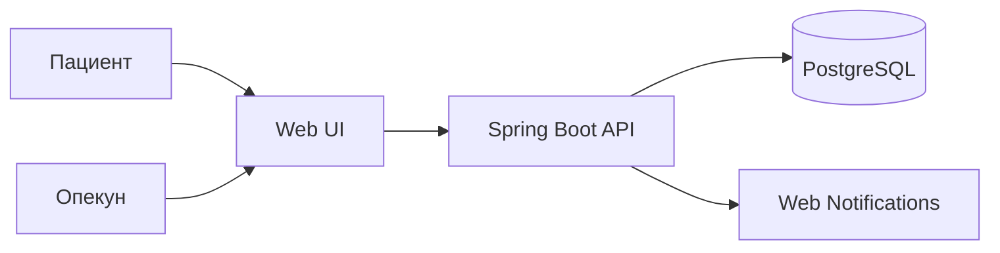

# Описание дизайна программного обеспечения

**Для веб-приложения Medora (учёт приёма лекарств)**  
**Версия:** 0.2 (проект)  
**Подготовил:** Зелень Александр Иванович  
**Организация:** БГУИР, ФКСиС, кафедра ЭВМ  
**Дата изменения:** 2026-11-09

## Оглавление

- [1. Введение](#1-introduction)
- [2. Обзор дизайна](#2-design-overview)
- [3. Проектные представления](#3-design-views)
- [4. Решения](#4-decisions)
- [5. Приложения](#5-appendixes)

## История изменений

| Автор | Дата | Причина изменения | Версия |
|---|---|---|---|
| Зелень А. И. | 2026-11-09 | Первоначальное описание архитектуры на основе SRS ЛР3 | 0.1 |
| Зелень А. И. | 2026-11-09 | Учёт итогов согласования с заказчиком: MVP-план и REQ-FUNC-010 | 0.2 |

---

## 1. Введение {#1-introduction}

### 1.1 Назначение документа {#11-document-purpose}

Данный SDD описывает проектируемую архитектуру веб-приложения **Medora**, основные компоненты, их обязанности, способы взаимодействия и структуру данных. Документ предназначен для разработчиков, архитектора, тестировщика и сопровождающего специалиста. Он служит основой для реализации требований из SRS и оценки последствий будущих изменений.

### 1.2 Область применения {#12-subject-scope}

Medora — веб-приложение для персонального учёта приёма лекарств: справочник препаратов, расписание, отметки «принято»/«пропущено», напоминания, учёт остатков и история приёма. После второго раунда согласования в MVP включён **режим опекуна** (`REQ-FUNC-010`): доверенное лицо может просматривать расписание подопечного и получать уведомления о пропущенных дозах.

В текущую область проектирования **не входят**: электронные рецепты, интеграция с аптеками/страховыми, телемедицина, AI-рекомендации по лечению, нативные мобильные приложения, email/SMS-напоминания (отложены после раунда 1).

### 1.3 Определения, акронимы и сокращения {#13-definitions-acronyms-and-abbreviations}

| Термин | Определение |
|---|---|
| ADR | Architecture Decision Record — запись о принятом архитектурном решении |
| API | Программный интерфейс взаимодействия компонентов |
| Backend | Серверная часть (Spring Boot) |
| Frontend | Пользовательская часть веб-приложения |
| JSON | Формат обмена структурированными данными |
| MVP | Минимально жизнеспособная версия продукта |
| Опекун | Пользователь с делегированным доступом к данным подопечного |
| REST | Подход к организации интерфейса клиент–сервер |
| SDD | Software Design Description |
| SRS | Software Requirements Specification |

### 1.4 Ссылки {#14-references}

| Документ | Тип | Назначение | Расположение |
|---|---|---|---|
| SRS Medora | Основной | Функциональные и нефункциональные требования | `../srs/srs.md` |
| SysML-модели экранов | Справочный | Структура UI | `../docs/sysml/` |
| План ЛР4 | Проектный | Приоритеты, итерации, смета | `../docs/lab4/` |
| ADR проекта | Проектный | Обоснование архитектурных решений | `../adr/` |

### 1.5 Обзор документа {#15-document-overview}

Раздел 2 фиксирует интересы стейкхолдеров и выбранные точки зрения. Раздел 3 описывает компоненты, данные и сценарии. Раздел 4 содержит краткие архитектурные решения (детали — в ADR). Раздел 5 — приложения. Документ обновляется при согласовании изменений с заказчиком.

---

## 2. Обзор дизайна {#2-design-overview}

### 2.1 Задачи стейкхолдеров {#21-stakeholder-concerns}

| Участник | Основные интересы | Отражение в проекте |
|---|---|---|
| Пациент / пользователь | Не пропускать приём, видеть остатки, быстро отмечать дозу | Главный экран «Сегодня», карточка лекарства, напоминания |
| Опекун | Контролировать соблюдение режима подопечного | Модуль делегированного доступа, уведомления о пропусках |
| Заказчик | Ключевой функционал в срок и бюджет | Модульная архитектура, MVP и отложенные функции |
| Разработчик | Разделение слоёв, тестируемость | Spring Boot + UI + PostgreSQL |
| Тестировщик | Проверяемые критерии приёмки | Сценарии DV и матрица верификации SRS |
| Сопровождающий | Диагностика и безопасные изменения | Журналирование, внешняя конфигурация |

### 2.2 Выбранные точки зрения {#22-selected-viewpoints}

#### 2.2.1 Контекст {#221-context}

Пользователь (и опционально опекун) работает через браузер. Система хранит персональные данные о расписании и приёме на сервере. Внешние зависимости MVP: PostgreSQL; браузерные уведомления (опционально, при разрешении). Email/SMS и аптеки — вне MVP.

#### 2.2.2 Композиция {#222-composition}

Архитектура: веб-клиент → REST API (Spring Boot) → PostgreSQL. Модули: аутентификация, лекарства, расписание, отметки приёма, напоминания/пропуски, остатки, история, делегирование доступа (опекун).

#### 2.2.3 Логическое представление {#223-logical}

Ключевые сущности: `User`, `Medicine`, `ScheduleRule`, `Dose`, `IntakeEvent`, `Stock`, `CaregiverLink`, `Notification`.

#### 2.2.4 Физическое представление {#224-physical}

Клиент — браузер пользователя; приложение и БД — учебный сервер/локальный стенд. Специальное оборудование не требуется.

#### 2.2.5 Структура {#225-structure}

Клиент: экраны Dashboard и Medicine Card (см. SysML). Сервер: controllers → services → repositories. Модуль уведомлений формирует события по расписанию доз.

#### 2.2.6 Зависимости {#226-dependency}

Расписание зависит от лекарств; дозы — от правил расписания; отметки влияют на остаток; пропуски порождают уведомления; опекунский доступ зависит от аутентификации и явного согласия владельца данных.

#### 2.2.7 Информация {#227-information}

Сохраняются учётные записи, препараты, правила расписания, факты приёма/пропуска, остатки, связи опекун–подопечный, журнал уведомлений. Медицинская «правильность» дозировок системой не валидируется.

#### 2.2.8 Интерфейс {#228-interface}

HTTP JSON API (`/api/auth`, `/api/medicines`, `/api/schedule`, `/api/doses`, `/api/stock`, `/api/history`, `/api/caregivers`). Ошибки валидации и авторизации возвращаются структурировано.

#### 2.2.9 Взаимодействие {#229-interaction}

Типовой сценарий: пользователь отмечает дозу → сервер обновляет статус, уменьшает остаток (идемпотентно), пишет историю → клиент обновляет Dashboard. Для опекуна: сервер проверяет `CaregiverLink` перед выдачей данных подопечного.

#### 2.2.10 Алгоритм {#2210-algorithm}

Генерация доз: по `ScheduleRule` на календарный день создаются плановые `Dose`. Пропуск: если статус не подтверждён в окне (по умолчанию 30 мин), статус → `MISSED`, создаётся уведомление однократно. Низкий остаток: `quantity <= threshold`.

#### 2.2.11 Динамика состояний {#2211-state-dynamics}

Доза: `PLANNED` → `TAKEN` | `MISSED` | `SKIPPED`. Связь опекуна: `PENDING` → `ACTIVE` | `REVOKED`.

#### 2.2.12 Параллелизм {#2212-concurrency}

Повторная отметка одной дозы не должна дважды списывать остаток (идемпотентность, `REQ-REL-002`). Планировщик напоминаний и пользовательские запросы могут пересекаться; согласованность обеспечивается транзакциями БД.

#### 2.2.13 Паттерны {#2213-patterns}

Многослойный монолит (Controller–Service–Repository); REST API; Session/JWT для аутентификации; принцип наименьших привилегий для опекунского доступа.

#### 2.2.14 Развёртывание {#2214-deployment}

Одно приложение Spring Boot + PostgreSQL (+ статический/отдельный фронтенд). Опционально Docker для учебного стенда.

#### 2.2.15 Ресурсы {#2215-resources}

Критичны соединения с БД и периодические задачи напоминаний. Нагрузка MVP — до ~100 одновременных пользователей (`REQ-PERF-001`).

---

## 3. Проектные представления {#3-design-views}

### DV-001 — Контекст и состав системы

- **ID:** DV-001
- **Title:** Контекст и функциональная декомпозиция
- **Viewpoint:** Контекст, композиция, структура
- **Representation:** Пользователь/опекун → UI → Spring Boot API → PostgreSQL. Модули соответствуют функциям SRS. Структуру экранов задают SysML-модели `Medora_Dashboard` и `Medora_Medicine`.
- **More Information:** `REQ-FUNC-001`–`010`, `REQ-INT-001`–`002`; AD-001, AD-002.

### DV-002 — Модель данных

- **ID:** DV-002
- **Title:** Данные учёта приёма лекарств
- **Viewpoint:** Логическое представление, информация
- **Representation:**

| Сущность | Основные поля | Назначение |
|---|---|---|
| `User` | `id`, `email`, `password_hash` | Учётная запись |
| `Medicine` | `id`, `user_id`, `name`, `dosage`, `form` | Препарат пользователя |
| `ScheduleRule` | `id`, `medicine_id`, `times`, `days`, `course_end` | Правила расписания |
| `Dose` | `id`, `rule_id`, `planned_at`, `status` | Плановая доза |
| `IntakeEvent` | `id`, `dose_id`, `recorded_at`, `status` | Факт отметки |
| `Stock` | `id`, `medicine_id`, `quantity`, `threshold` | Остаток |
| `CaregiverLink` | `id`, `owner_id`, `caregiver_id`, `status`, `scopes` | Делегированный доступ |
| `Notification` | `id`, `user_id`, `type`, `payload`, `created_at` | Напоминания и пропуски |

- **More Information:** AD-003; `REQ-INT-011`, `REQ-FUNC-009`, `REQ-FUNC-010`.

### DV-003 — Отметка приёма и остатки

- **ID:** DV-003
- **Title:** Обработка отметки дозы
- **Viewpoint:** Взаимодействие, алгоритм
- **Representation:**
  1. Клиент отправляет `POST /api/doses/{id}/mark` со статусом.
  2. Сервер проверяет владельца (или активную связь опекуна с правом `mark`).
  3. Если доза уже обработана — вернуть текущее состояние без повторного списания.
  4. Иначе обновить статус, записать `IntakeEvent`, при `TAKEN` уменьшить `Stock`.
  5. Вернуть обновлённый Dashboard-снимок.
- **More Information:** `REQ-FUNC-004`, `007`, `REQ-REL-001`–`002`.

### DV-004 — Напоминания и пропуски

- **ID:** DV-004
- **Title:** Формирование напоминаний и пропусков
- **Viewpoint:** Алгоритм, динамика состояний
- **Representation:** Фоновая задача сканирует ближайшие `PLANNED` дозы. За `offset` минут (по умолчанию 5) создаётся напоминание в UI / Web Notification. По истечении окна без подтверждения — `MISSED` + уведомление владельцу и активным опекунам.
- **More Information:** `REQ-FUNC-005`, `006`, `010`; AD-004.

### DV-005 — Режим опекуна

- **ID:** DV-005
- **Title:** Делегированный доступ
- **Viewpoint:** Интерфейс, безопасность
- **Representation:** Владелец создаёт приглашение (email). Опекун принимает → `ACTIVE`. API всех защищённых ресурсов проверяет либо `owner_id == currentUser`, либо активный `CaregiverLink` с нужным `scope` (`read_schedule`, `read_history`, `receive_missed`). Отзыв связи мгновенно закрывает доступ.
- **More Information:** `REQ-FUNC-010`, `REQ-FUNC-009`, `REQ-SEC-003`.

### DV-006 — Обмен данными

- **ID:** DV-006
- **Title:** Контракты REST API
- **Viewpoint:** Интерфейс
- **Representation:** Группы: `/api/auth`, `/api/medicines`, `/api/schedule`, `/api/doses`, `/api/stock`, `/api/history`, `/api/caregivers`, `/api/notifications`. Имена уточняются при реализации; ответы — JSON + корректные HTTP-коды.
- **More Information:** `REQ-INT-010`, AD-002.

---

## 4. Решения {#4-decisions}

### AD-001 — Стек Java / Spring Boot

- **ID:** AD-001
- **Title:** Серверная платформа Spring Boot
- **Context:** SRS фиксирует Java для серверной части; нужны REST, безопасность и работа с БД.
- **Options:** Spring Boot; другой Java-фреймворк; Node.js backend.
- **Outcome:** Выбран **Spring Boot** — соответствует ограничениям SRS, есть экосистема Security/Data.
- **More Information:** см. `../adr/001-medora-architecture.md`.

### AD-002 — Клиент–сервер с REST

- **ID:** AD-002
- **Title:** Разделение UI и backend через HTTP API
- **Context:** Нужны единые правила для UI, напоминаний и опекунского доступа.
- **Options:** Вся логика в браузере; классический монолит с server-side templates; микросервисы.
- **Outcome:** **Один серверный монолит + веб-клиент (шаблоны или SPA)**. Микросервисы избыточны для учебного MVP.
- **More Information:** ADR-001.

### AD-003 — PostgreSQL

- **ID:** AD-003
- **Title:** Реляционное хранение
- **Context:** Связанные сущности и требования целостности/идемпотентности.
- **Options:** PostgreSQL; другая РСУБД; только файлы/браузерное хранилище.
- **Outcome:** **PostgreSQL**.
- **More Information:** `REQ-INT-011`, `REQ-REL-001`.

### AD-004 — Каналы уведомлений MVP

- **ID:** AD-004
- **Title:** UI + опциональный Web Push; без email/SMS в MVP
- **Context:** После раунда 1 заказчик согласился упростить канал доставки, чтобы уложиться в сроки.
- **Options:** Только UI; UI + Web Push; UI + email/SMS.
- **Outcome:** **UI + Web Push при разрешении**. Email/SMS — post-MVP.
- **More Information:** согласование в `../docs/lab4/`.

### AD-005 — Режим опекуна в MVP

- **ID:** AD-005
- **Title:** Включение REQ-FUNC-010 без сдвига дедлайна
- **Context:** Во втором раунде заказчик потребовал семейный контроль без переноса срока.
- **Options:** Отложить; сдвинуть дедлайн; добавить junior и выделить спринт.
- **Outcome:** Включено в MVP за счёт **junior-разработчика** на 2 недели и перераспределения задач.
- **More Information:** итоговый план и смета в `../docs/lab4/plan.md`.

---

## 5. Приложения {#5-appendixes}

### 5.1 Контекстная схема (Mermaid)

### 5.2 Связанные материалы

- [SRS](../srs/srs.md)
- [ADR](../adr/001-medora-architecture.md)
- [План и смета ЛР4](../docs/lab4/plan.md)
- [Переписка с заказчиком](../docs/lab4/переписка.md)
- SysML: `../docs/sysml/Medora_Dashboard.sysml`, `../docs/sysml/Medora_Medicine.sysml`
